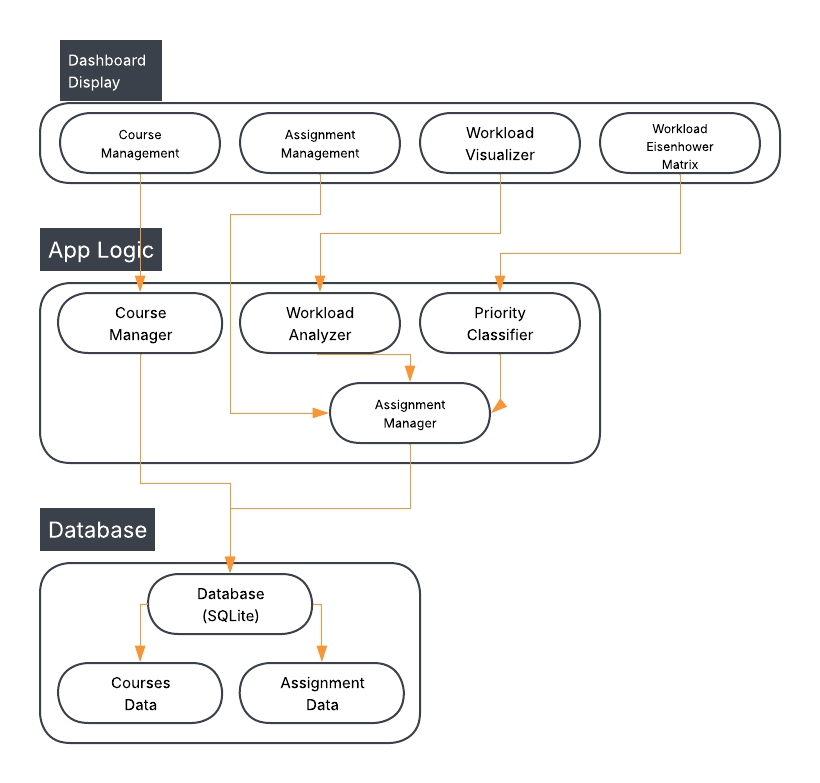

# student-intelligence-dashboard

A complete dashboard for all academic management, specifically for Purdue students. It will have the ability to track courses, monitor and visualize performance, and organize their upcoming workload.

## The Problem

College students currently do have tools to manage their academics and mark deadlines, but they generally don't have the ability to help analyze workload, prioritize tasks, and monitor academic performance from a single dashboard.

## How It Works

A paragraph or a few bullets explaining what the software does at a
high level. If you have a diagram, embed it here:



## Tech Stack

- **Language:** Python
- **Libraries:** pandas, Plotly, datetime
- **External tools:** SQLite database

## Setup

```bash
git clone https://github.com/you/student-intelligence-dashboard.git
cd student-intelligence-dashboard
```